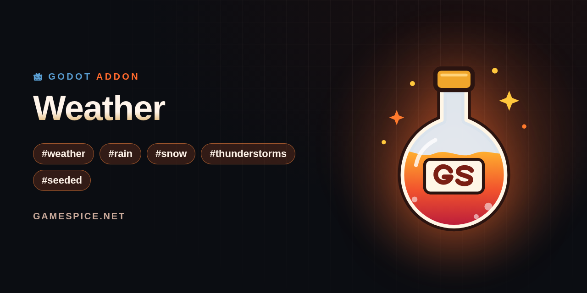

[](https://moddingcommunity.com/a/267-dot-weather)

Everyday weather for Godot games: snow, rain, thunderstorms, wind and fog, described per map as a document, so any game gets them by adding a node.

## Install

1. Get [Godot 4.7](https://godotengine.org/download).
2. Either use [dot-bootstrap](https://github.com/gamespice-platform/bootstrap), which clones every project and links the addons, or copy `addons/dot_weather/` and [dot-core](https://github.com/gamespice-platform/core)'s `addons/dot_core/` into your project and enable dot-weather in *Project > Project Settings > Plugins*.

| Addon | Needed? | What it adds |
| --- | --- | --- |
| dot-core | Required | Config and results. |
| [dot-fx](https://github.com/gamespice-platform/fx) (API level 5 or newer) | Optional | Draws the precipitation, volumes included. |
| [dot-lighting](https://github.com/gamespice-platform/lighting) (API level 6 or newer) | Optional | Writes the fog onto the world's environment. |

A dedicated server with neither still parses documents, runs the lightning schedule and emits the signals.

## Use

```gdscript
var weather := DotWeather.new()
add_child(weather)
var res := weather.apply(map_document["weather"])      # a DotResult; a bad document is refused and names the key
weather.lightning.connect(func(strike, level): ...)     # add a sound, a light, a shake
weather.thunder.connect(func(sound, strike, metres, loudness): audio.play(sound, loudness))
weather.ambience_changed.connect(func(ids): ...)        # {"loop": id, "wind": id}: start your own loops

# once a frame, with the camera and the clock every client shares:
weather.advance(delta, camera.global_position, match_time_seconds)
var wind: Vector3 = weather.wind()                      # for foliage, flags, smoke
```

A document (every section optional, unknown keys refused, distances in metres):

```json
{
  "seed": 1234,
  "precipitation": {"kind": "rain", "density": 1.2, "colour": "#c8d8ff", "volumes": [{"min": [-40, 0, -40], "max": [40, 30, 40]}]},
  "fog": {"colour": [0.5, 0.55, 0.62], "start": 8, "end": 120, "max_density": 0.9},
  "wind": {"vector": [3, 0, 1], "gust": 0.8, "gust_period": 9},
  "thunder": {"mean_interval": 14, "chance": 0.8, "centre": [0, 0, 0], "min_distance": 80, "max_distance": 900,
              "height": 220, "flash": {"sky": 1.6, "ambient": 0.8, "duration": 0.45}, "bolt": true},
  "ambience": {"loop": "amb_rain", "wind": "amb_wind", "thunder": ["thunder_a", "thunder_b"]}
}
```

## Lightning without network traffic

Strikes are a pure function of the document's seed and the shared match time you pass to `advance()`. Every client agrees on when and where, a late joiner sees the same storm, and a replay can seek. Thunder arrives later by distance, per listener. See [docs/design.md](docs/design.md#lightning-in-sync-without-networking).

## Accessibility

| Setting | Default | Meaning |
| --- | --- | --- |
| `DotWeatherConfig.allow_flashes` | true | Turn lightning flashes off. |
| `DotWeatherConfig.flash_scale` | 1.0 | Scale flash brightness, down to 0. |
| `DotWeatherConfig.min_thunder_interval` | 3.0 | Shortest thunder `mean_interval` a document may ask for. Default 3 s, any value; 0 is no floor. Negative is refused. |

To keep to the guidance of no more than three general flashes per second, by default a document with a `mean_interval` under 3 seconds is refused. That is an accessibility default, not a limit: an operator who lowers `min_thunder_interval` gets the faster storm, with a warning logged each time one is applied. There is no upper limit on the interval.

## Try it

Run `examples/weather_demo.tscn` (add `-- --mode rain`; keys 1 to 4 switch snow, rain, fog and flash) to see it, and `examples/weather_selftest.tscn` headless with Godot for the tests.

## Status and licence

Part of the [**GameSpice**](https://gamespice.net) platform: a family of Godot addons. Written with Claude Code and maintained by `gamemann`. Every addon has headless tests, but little of this has been played by real users yet, so expect rough edges and please [open an issue](https://github.com/gamespice-platform/weather/issues) when you hit one.

MIT licence, see [LICENSE](LICENSE). The only closed part of the [**GameSpice**](https://gamespice.net) platform is the web back end; you can use your own instead of GameSpice's.
